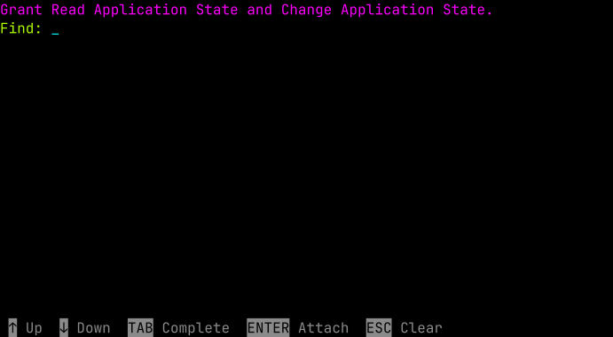

# Zellij Session Manager

[](https://github.com/fulldecent/zellij-session-manager-ng/actions/workflows/lint.yml) [](https://github.com/fulldecent/zellij-session-manager-ng/actions/workflows/build-test.yml)

A window for the sessions on this machine. Attach to a running session, resurrect a saved one, or start a new session from a layout.



This is a [Zellij](https://zellij.dev/) plugin and supports Zellij 0.45 or newer.

## Try it out

1. Select the latest wasm release and install to your plugins folder:

   ```sh
   name="com.github.fulldecent.zellij-session-manager-ng.wasm"
   base="https://github.com/fulldecent/zellij-session-manager-ng/releases/latest/download"
   mkdir -p ~/.config/zellij/plugins
   curl -fL -o ~/.config/zellij/plugins/"$name" "$base/$name"
   curl -fL -o ~/.config/zellij/plugins/"${name}.sigstore.jsonl" "$base/${name}.sigstore.jsonl"
   ```

   If you have the `gh` command, verify the file build attestation:

   ```sh
   gh attestation verify ~/.config/zellij/plugins/"$name" \
     -R fulldecent/zellij-session-manager-ng \
     --bundle ~/.config/zellij/plugins/"${name}.sigstore.jsonl"
   ```

2. Start a new session (or tab if already in Zellij):

   ```sh
   zellij --layout-string 'layout {
       pane size=1 borderless=true {
           plugin location="tab-bar"
       }
       pane
       pane size=1 borderless=true {
           plugin location="status-bar"
       }
       floating_panes {
           pane name="Sessions" focus=true x="10%" y="8%" width="80%" height="75%" {
               plugin location="file:~/.config/zellij/plugins/com.github.fulldecent.zellij-session-manager-ng.wasm"
           }
       }
   }'
   ```

   Grant `Read Application State` and `Change Application State` when Zellij asks. Click that pane and press `y`.

## Usage

The window opens in Find. The floating pane border is the breadcrumb: `Sessions > Find` while Find has the keys, `Sessions` after Find is closed, `Sessions > New` for a new session, `Sessions > Rename` while renaming, and `Sessions > Kill All` while confirming.

The field is `Find:`. `/` enters it when it does not already have the keys. The bar is a row of keys. A key and its label are one control. Click either one. Key names are `ENTER`, `ESC`, `TAB`, and `DEL`.

### Sessions

The list is the running sessions, current session first, then saved sessions that can be resurrected. A running row shows clients and tabs. The current row says current. A saved row says exited and how long ago it was created.

| Key   | Action                                                                  |
| ----- | ----------------------------------------------------------------------- |
| ENTER | Attach, resurrect, or open New for a name with no session               |
| ↑ ↓   | Move the selection                                                      |
| TAB   | Fill `Find:` with the selected name, while Find is open                 |
| ESC   | Clear Find, leave Find, or close the window                             |
| /     | Open Find again                                                         |
| N     | Open New for the typed name, after Find is closed                       |
| R     | Rename the current session, after Find is closed                        |
| DEL   | Kill the selected running session, or delete the selected saved session |
| X     | Disconnect other clients from the current session                       |
| A     | Save the current session so it can be resurrected                       |
| ^A    | The same save, while Find is closed                                     |
| D     | Ask to kill every other running session                                 |
| ^D    | The same question                                                       |

A typed letter goes into `Find:` while that field has the keys, so `N`, `R`, `X`, `A`, and `D` are not drawn then.

ENTER on the current session reports that you are already in it. ENTER on another running session attaches. ENTER on a saved session resurrects it. ENTER on a typed name that matches no session opens New.

### Sessions > New

The page lists the layouts from the current session. ENTER starts a session with the selected layout and the name from Find. An empty name receives an adjective-noun name. ESC returns to the list.

A name must be shorter than 108 bytes and cannot contain `/`.

### Sessions > Rename

`Name:` starts as the current session name. ENTER renames that session. ESC cancels. A name that another session already uses is rejected.

### Sessions > Kill All

ENTER kills every running session except the current one. ESC cancels.

## Development

Thank you for taking an interest in improving Zellij Session Manager.

You will need Git, your platform's native build tools and the Rust tooling described in [rust-toolchain.toml](rust-toolchain.toml). We recommend rustup to manage your rust tooling, but install it using your system package manager rather than the dangerous methods on the rustup website ([ref](#references)).

### Linux

On Ubuntu 22.04+ or Debian 12+:

```sh
sudo apt update
sudo apt install git build-essential rustup
```

On Fedora:

```sh
sudo dnf install git gcc rustup
```

If your distribution has no `rustup` package, follow [other rustup installation methods](https://rust-lang.github.io/rustup/installation/other.html).

### macOS

```sh
xcode-select --install
brew install git rustup
```

Homebrew's `rust` formula is a standalone compiler. It does not honor `rust-toolchain.toml`. Use `rustup` instead.

### Windows

```powershell
winget install --exact --id Git.Git
winget install --exact --id Microsoft.VisualStudio.2022.BuildTools --override "--wait --passive --norestart --add Microsoft.VisualStudio.Workload.VCTools --includeRecommended"
winget install --exact --id Rustlang.Rustup
```

Clone the project and build. On Linux and macOS:

> [!NOTE]
> If you do not require cross compilation, remove the `DYLD_LIBRARY_PATH="..."` part of all commands in this README.

```sh
git clone https://github.com/fulldecent/zellij-session-manager-ng.git
cd zellij-session-manager-ng
rustup show
cargo_bin=$(rustup which cargo)
export PATH="$(dirname "$cargo_bin"):$PATH"
export DYLD_LIBRARY_PATH="$(cd "$(dirname "$cargo_bin")/../lib" && pwd)" # macOS only; omit on Linux
cargo check --locked
cargo build --locked
```

In PowerShell:

```powershell
git clone https://github.com/fulldecent/zellij-session-manager-ng.git
Set-Location zellij-session-manager-ng
rustup show
$cargo = rustup which cargo
if (-not $cargo) { exit 1 }
$bin = Split-Path $cargo
$env:PATH = "$bin;$env:PATH"
cargo check --locked
cargo build --locked
```

Run this directly with:

```sh
zellij --layout layout/dev.kdl
```

[layout/dev.kdl](layout/dev.kdl) opens a focused floating pane named Sessions. The plugin path is relative to the directory where you start Zellij.

### Testing

```sh
rustup show
cargo_bin=$(rustup which cargo)
export PATH="$(dirname "$cargo_bin"):$PATH"
export DYLD_LIBRARY_PATH="$(cd "$(dirname "$cargo_bin")/../lib" && pwd)" # macOS only; omit on Linux
cargo test --locked --target "$(rustc -vV | sed -n 's/^host: //p')"
cargo fmt --all -- --check
cargo clippy --all-targets --locked -- -D warnings
cargo build --release --locked
```

`cargo test` runs the Rust tests in `src/`. [tests/snapshot.sh](tests/snapshot.sh) builds the release wasm, runs every script in [shots/](shots/), and exits non-zero unless those bytes match the committed `shots/*.ansi.txt` files. SVG is traced. `diff` does not compare it. The picture is committed as [screenshot.svg](screenshot.svg) at the repository root.

```sh
rustup show
cargo_bin=$(rustup which cargo)
export PATH="$(dirname "$cargo_bin"):$PATH"
export DYLD_LIBRARY_PATH="$(cd "$(dirname "$cargo_bin")/../lib" && pwd)" # macOS only; omit on Linux
cargo install zellij-plugin-snapshot --version 0.2.2 --locked
sh tests/snapshot.sh
```

The host is [Zellij Plugin Snapshot](https://github.com/fulldecent/zellij-plugin-snapshot) 0.2.2. Install that published crate once. `cargo install` compiles it and puts `zellij-plugin-snapshot` on `PATH`. `[dependencies]` would compile it into the plugin wasm. This host is a command, so that field leaves it uninstalled.

`tests/snapshot.sh` passes `--target wasm32-wasip1`. [.cargo/config.toml](.cargo/config.toml) selects that target for a plain `cargo build`. The flag keeps the snapshot build on the plugin wasm if that default is removed.

```sh
npx prettier@latest --check . --write
npx markdownlint-cli@latest "**/*.md" --fix
```

### Releases

Use `fix:`, `feat:` or `BREAKING CHANGE:` in your commit messages. When you push commits to `main`, the release workflow will create a pull request which bumps the version and kicks off a release when you merge.

The [release workflow](.github/workflows/release.yml) uses Release Please's `rust` release type. That pull request bumps the version in [Cargo.toml](Cargo.toml) and [Cargo.lock](Cargo.lock). The package name is `plugin`. `include-component-in-tag: false` keeps the tag `vMAJOR.MINOR.PATCH`. A tag shaped `plugin-v1.2.3` does not pass the publish step.

The released binary is named `com.github.fulldecent.zellij-session-manager-ng.wasm`. [Build and test](.github/workflows/build-test.yml) builds and tests that wasm, then attests and uploads it. The release also includes `com.github.fulldecent.zellij-session-manager-ng.wasm.sigstore.jsonl`. The sidecar records the release version. The wasm file name is stable across versions.

In GitHub repository settings, under Actions, General, Workflow permissions, select read and write permissions and check "Allow GitHub Actions to create and approve pull requests". Under General, Releases, enable release immutability. Attestations are available for public repositories. Private repositories require GitHub Enterprise Cloud.

Set the starting tag on the current `main` commit. `v0.0.0` is the version Release Please counts forward from. Run these commands from a clone of this repository. `gh` fills in `{owner}/{repo}` from that clone.

```sh
gh api --method POST repos/{owner}/{repo}/git/refs \
  -f ref="refs/tags/v0.0.0" \
  -f sha="$(gh api repos/{owner}/{repo}/commits/main --jq .sha)"
```

### Maintenance

The project administrator completes these maintenance tasks each month.

1. Identify external Actions in [.github/workflows](./.github/workflows) and update them when it is safe.
1. Review the Rust toolchain in `rust-toolchain.toml`.
1. Review [zellij-plugin-snapshot](https://github.com/fulldecent/zellij-plugin-snapshot) releases. Update every `cargo install zellij-plugin-snapshot --version` line. Regenerate each `shots/*.ansi.txt` and its SVG when the host output changes. Commit [screenshot.svg](screenshot.svg) at the repository root. Commit the other SVG files beside their YAML scripts.

## Project scope

This window is for people who have more than one Zellij session and want to attach, resurrect, or start one without leaving the terminal.

In scope:

- List running sessions and saved sessions
- Attach, resurrect, rename the current session, kill another session, or delete a saved session
- Disconnect other clients and save the current session for resurrection
- Start a new session from a layout

Out of scope:

- The multi-screen welcome banner from the built-in session manager
- Choosing a folder with the file picker when starting a session
- Replacing the built-in `zellij:session-manager` alias in a stock layout

## References

1. A popup plugin puts its breadcrumb in the window title. A find mode is `Sessions > Find`. The field is `Find:`. `/` enters it. Key names are `ENTER`, `ESC`, `TAB`, and `DEL`. These rules are in Zellij Style Guide Next Generation, taken from [zellij-status-bar-ng 1.1.1](https://github.com/fulldecent/zellij-status-bar-ng), [zellij-compact-bar-ng 0.2.1](https://github.com/fulldecent/zellij-compact-bar-ng), and [zellij-tab-bar-ng 0.2.1](https://github.com/fulldecent/zellij-tab-bar-ng).
1. This project is built based on [best practices documented in zellij-plugin-template](https://github.com/fulldecent/zellij-plugin-template), release 0.5.0.
1. Session list, attach, resurrect, rename, kill, and save follow the built-in session manager in Zellij 0.45.1. The source is [`default-plugins/session-manager` at v0.45.1](https://github.com/zellij-org/zellij/tree/v0.45.1/default-plugins/session-manager). This window is the single-screen form of that plugin.
1. We use a workaround so that rustup works without replacing your system Rust programs ([issue](https://github.com/rust-lang/rustup/issues/5025#issuecomment-6869331794)).
1. Render snapshots follow [Zellij Plugin Snapshot](https://github.com/fulldecent/zellij-plugin-snapshot) 0.2.2.
1. This project is released under the [MIT license](./LICENSE.md).
